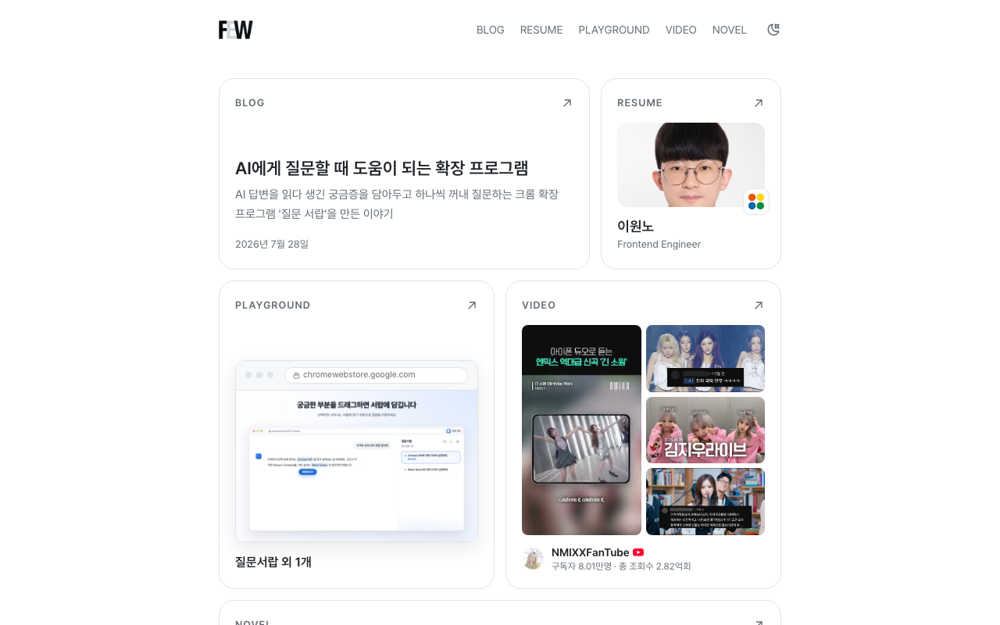

# leewonno.github.io

프론트엔드 개발자 이원노의 개인 사이트입니다. 흩어져 있던 글과 이력, 프로젝트, 창작물을 한곳에 모았습니다.

**[사이트 바로가기](https://leewonno.github.io/)**

## 페이지 안내

| 페이지 | 이런 내용을 볼 수 있습니다 |
| --- | --- |
| [RESUME](https://leewonno.github.io/resume/) | 경력, 학력, 자격증, 연락처 |
| [BLOG](https://leewonno.github.io/blog/) | 기술 블로그 |
| [PLAYGROUND](https://leewonno.github.io/playground/) | 직접 만든 개인 프로젝트 |
| [VIDEO](https://leewonno.github.io/video/) | 유튜브 채널과 영상 목록 |
| [NOVEL](https://leewonno.github.io/novel/) | 연재 소설 |

## 만든 방식

React, TypeScript, Vite, Tailwind CSS 로 만들고 GitHub Actions 로 GitHub Pages 에 배포합니다.

- **프리렌더링:** GitHub Pages 는 파일이 없는 경로를 404 로 응답하므로, 빌드할 때 경로마다 본문이 채워진 HTML 을 생성합니다. ([entry-server.tsx](src/entry-server.tsx), [prerender.mjs](scripts/prerender.mjs))
- **콘텐츠 관리:** 글은 마크다운, 나머지는 TypeScript 데이터 파일로 관리하고, 글의 frontmatter 형식이 틀리면 빌드가 실패합니다. ([posts.ts](src/lib/posts.ts))
- **댓글:** 서버 없이 [giscus](https://giscus.app) 로 이 저장소의 GitHub Discussions 에 저장합니다. ([Comments.tsx](src/components/Comments.tsx))
